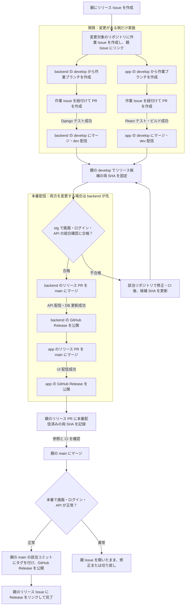

# Emonotate

Draw and collect emotional arcs.

This repository is a monorepo containing the frontend and backend for Emonotate.

| Directory | Description |
|---|---|
| [emonotate-app/](emonotate-app/) | React.js frontend |
| [emonotate-backend/](emonotate-backend/) | Python (Django) backend |

## 感情曲線の入力

ログイン後、ホームで素材とタイトルを選びます。YouTube は動画 URL を貼り付けて開始できます。動画ファイルは MP4・WebM（最大 1 GiB）、テキストは本文の貼り付けか UTF-8 の .txt（最大 2 MiB）に対応します。動画では秒数、テキストでは読書位置（0〜100%）を横軸に使います。グラフをクリックして点を追加し、ドラッグで調整します。保存した曲線は「履歴」から開けます。

## AWS・Neon 構成

CloudFront が React と Django API を同一オリジンで配信します。Cognito の認可コードと PKCE で本人確認し、Django のセッションを Neon PostgreSQL に保存します。ユーザーの識別にはユーザープール ID と `sub` を使用します。動画・テキストは非公開 S3 に直接アップロードし、データベースには素材と曲線の関係、座標、オブジェクトキーを保存します。

### 開発環境のセットアップ

1. Neon で開発用ブランチを選び、TLS 付きのプール接続 URL を用意します。本番には別のブランチまたはプロジェクトを使います。
2. `ENV=dev bash scripts/setup-secrets.sh` で接続 URL と Django の秘密鍵を登録します。既存環境を移す場合は登録済みの秘密鍵を引き継ぎます。Lambda は起動時に Secrets Manager の `emonotate-dev-django` を取得します。
3. Terraform 1.7 以上で `terraform -chdir=terraform/environments/dev init`、続いて `plan` を実行し、差分を確認して適用します。初回は既存の `terraform/bootstrap` の状態バケット・ロックテーブルと、ブートストラップイメージを作成する Docker が必要です。旧構成の `db_password`、`django_secret_key`、`cloudfront_domain` の tfvars は不要です。
4. フロントエンドとバックエンドは Git サブモジュールです。それぞれのリポジトリの `develop` に push すると dev に、`master` に push すると本番に配信されます。バックエンドは Lambda の更新とマイグレーション、フロントエンドは S3・CloudFront への配信を行います。親リポジトリの参照は、配信後に更新してください。本番環境の初回構築では同一リージョンの利用可能なプライベート ECR イメージ URI を `ecr_image_uri` に渡します。
5. `terraform -chdir=terraform/environments/dev output -raw cloudfront_domain` で表示されたホストを HTTPS で開きます。`ENV=dev bash scripts/e2e-verify.sh` でログイン開始時のセッション作成と Cognito へのリダイレクトを確認できます。

YouTube の URL 入力には API キーは不要です。既存の YouTube 検索も使う場合はフロントエンドのビルド時に `REACT_APP_YOUTUBE_API_KEY` を指定します。

### dev・stg・prod のデプロイ

stg は Terraform 状態 `stg/terraform.tfstate` と `emonotate-stg-*` の AWS リソースを使用します。prod は既存の `prd/terraform.tfstate` と `emonotate-prd-*` を使用します。各環境の Secrets Manager（`emonotate-stg-django`、`emonotate-prd-django`）にはそれぞれの Neon 接続先と Django 秘密鍵を設定してください。端末でのデプロイ時にシークレットが見つからなければ、その環境の Django 秘密鍵を入力し、Neon CLI でプール接続 URL を取得します。プロジェクト名が `emonotate` で、対象のブランチ名（stg は `stg` または `staging`、本番は `prd`・`prod`・`production`）が一意なら自動選択します。別の名前を使う場合は `NEON_STG_PROJECT_ID` と `NEON_STG_BRANCH`、本番は `NEON_PRD_PROJECT_ID` と `NEON_PRD_BRANCH` で指定できます。URL の手入力は自動取得できなかった場合に求められます。新規環境では秘密鍵の欄で Enter を押すと生成します。既存環境を移行する場合は元の秘密鍵を入力してください。登録済みの有効な設定はそのまま使います。開発環境は `bash scripts/deploy-environment.sh dev` で、`emonotate-dev-django` を使用します。

AWS、Docker、Terraform、Node.js 18、jq を利用できる端末から次を実行します。現在の作業ツリーをビルドし、Terraform の差分を表示します。各環境で Lambda の更新・DB マイグレーション・CloudFront のキャッシュ更新を待ち、画面と Cognito リダイレクトを確認して URL を表示します。

```bash
bash scripts/deploy-environment.sh stg && bash scripts/deploy-environment.sh prod
```

dev と prod の GitHub Actions は、AWS アカウント共通の IAM OIDC プロバイダー `https://token.actions.githubusercontent.com` を参照します。新規 AWS アカウントでは、初回デプロイの前にこの URL と Audience `sts.amazonaws.com` で一度だけ登録してください。stg の手動デプロイには不要です。

各環境を一度手動で適用したあと、次の出力を GitHub Actions のシークレットに設定します(本番はディレクトリ `prd`、シークレット名の末尾は `_PRD`)。

| 出力 | 設定先 | 用途 |
|---|---|---|
| `ci_role_arn` | emonotate-app・emonotate-backend の `AWS_CI_ROLE_ARN_DEV` | アプリの配信。dev は両リポジトリの `develop`、本番は `master` から引き受けられます |
| `terraform_plan_role_arn` | このリポジトリの `AWS_TF_PLAN_ROLE_ARN_DEV` | PR での `terraform plan`(読み取り専用) |
| `terraform_apply_role_arn` | このリポジトリの `AWS_TF_APPLY_ROLE_ARN_DEV` | `develop`(本番は `main`)への push での `terraform apply` |

Terraform の変更はこのリポジトリで行います。`terraform/` を変える PR で差分(plan)を確認し、マージすると適用(apply)されます。`terraform/` に変更がない push では、このリポジトリのデプロイは動きません。移行時は旧共通ロールとインラインポリシーが AWS に残ります。両環境の切り替え後、ほかの利用先も確認して旧ロールを廃止してください。

### 既存データの引き継ぎ

旧 Aurora と VPC は、切り替え時に Terraform の管理対象から外して保持します。既存環境では保持中のリソースに引き続き費用が発生します。Terraform の適用でデータが Neon に転送されることはありません。

切り替える前に PostgreSQL のバックアップを取得し、隔離した Neon ブランチへ復元して、素材・曲線・利用者の ID と件数を照合してください。旧版の users テーブルに対応する初期マイグレーションは `users.0001_initial` です。旧環境で個別に生成したマイグレーションや `--run-syncdb` を利用した場合は、復元先の Django のマイグレーション履歴とテーブル定義を照合してから `migrate --fake-initial` を適用します。

既存アカウントは本人との対応を確認し、初回 Cognito ログイン前に `python manage.py link_cognito_user USER_ID COGNITO_SUB --settings=backend.settings.aws` で紐付けます。旧動画を非公開バケットに移した場合は `python manage.py link_s3_source CONTENT_ID OBJECT_KEY --settings=backend.settings.aws` で既存の素材に関連付けます。どちらも既存の曲線 ID を維持します。

### ローカル検証

`emonotate-backend` で `requirements-aws.txt` をインストールし、`python manage.py test users.test.test_cloud_annotation --settings=backend.settings.test_cloud` を実行します。テストは一時 SQLite と Cognito・S3 の模擬応答を使います。画面側のテストは `emonotate-app` で `CI=true npm test -- --runInBand` を実行します。

## Getting Started

Run the following command once after cloning:

```bash
make setup
```

This configures git to use the project's shared hooks in [.githooks/](.githooks/).

### Environment variables (required for `pre-push`)

The `pre-push` hook posts a comment to the task management API on every push.
Set the following variables in your shell profile (e.g. `~/.zshenv`):

```bash
export TOOL_API_URL="<comment endpoint URL>"
export TOOL_API_KEY="<API key>"
export TOOL_USER_ID=<user id>
```

## Git Commit Message Format

All commits must follow this format:

```
<kind>: <summary>

[<detail>]

Task: <task_id>
```

**Rules:**

| Field | Rule |
|---|---|
| `kind` | `Ftr` (feature) / `Fix` (bug fix) / `Eta` (estimate) |
| First line | ASCII only, 50 chars max, summary starts with uppercase |
| Detail lines | ASCII only, 50 chars max each (optional) |
| Blank lines | Required after first line, and before `Task:` |
| `task_id` | Integer |

**Examples:**

```
Ftr: Add user authentication

Task: 12
```

```
Fix: Correct off-by-one error in arc renderer

The end index was exclusive but treated as inclusive,
causing the last data point to be dropped.

Task: 34
```

The `commit-msg` hook enforces this format automatically after `make setup`.

## Git Hooks

| Hook | Trigger | Behavior |
|---|---|---|
| `commit-msg` | `git commit` | Validates commit message format |
| `pre-push` | `git push` | Posts a comment to the task management API for each pushed commit |

## Issue 作成から GitHub Release 公開まで

親リポジトリのリリース Issue で製品版を追跡し、変更するサブモジュール（backend・app）の作業 Issue をそこに紐付けます。次の図は両方を変更する場合の運用案です。

図中の子の `main` は本番ブランチ名を統一した後の名称です。現在の子の本番配信は `master` へのマージで起動します。ブランチ移行と Release 自動化の進捗は各 Issue で確認できます。[app #126](https://github.com/tombee-studio/emonotate-app/issues/126) · [backend #139](https://github.com/tombee-studio/emonotate-backend/issues/139) · [親 #19](https://github.com/tombee-studio/emonotate/issues/19)



- **片方だけを変更する場合**は、そのサブモジュールだけを配信します。親には、変更した側の配信済みコミット SHA と、もう一方で本番稼働中の SHA を記録します。
- **親のリリース PR** の本文では `Refs #番号` でリリース Issue を参照します。本番確認に成功し、製品版の GitHub Release を公開したら、その URL を Issue に記録して閉じます。

## GitHub Actions

| Workflow | Trigger | Behavior |
|---|---|---|
| [test](.github/workflows/test.yml) | PR to `develop`/`main`, called by deploys | React test and build; Django check, migration check, migrate on TLS PostgreSQL, Cognito tests |
| [require-linked-issue](.github/workflows/require-linked-issue.yml) | PR to `develop`/`main` | Fails unless the PR (`Closes #N` or Development sidebar) or its branch is linked to an issue |
| [terraform-plan](.github/workflows/terraform-plan.yml) | PR to `develop` / `main` that changes `terraform/` | Runs [terraform](.github/workflows/terraform.yml) `plan` against dev / prd (read-only role) and shows the diff in the job summary |
| [deploy-dev](.github/workflows/deploy-dev.yml) / [deploy-prd](.github/workflows/deploy-prd.yml) | push to `develop` / `main` that changes `terraform/` | Runs [terraform](.github/workflows/terraform.yml) `apply` for dev / prd, then checks the page and Cognito redirect through CloudFront |

Infrastructure changes are made in this repository: change `terraform/`, open a PR (plan), and merge (apply). The frontend ([emonotate-app](https://github.com/tombee-studio/emonotate-app)) and backend ([emonotate-backend](https://github.com/tombee-studio/emonotate-backend)) deploy the apps themselves: `develop` to dev and `master` to production, using the `ci_role_arn` role. Both use the same commit rules, hooks and checks as this repository.
| [update-task-status-on-merge](.github/workflows/update-task-status-on-merge.yml) | push to `develop` | Updates the status of each commit's task to merged |
| [validate-releases-pr](.github/workflows/validate-releases-pr.yml) | PR opened/edited to `releases` | Checks that the PR body contains `Event: <event_id>` |
| [update-event-status-on-merge-to-releases](.github/workflows/update-event-status-on-merge-to-releases.yml) | PR merged to `releases` | Updates the event status to released |

### Required GitHub Secrets

Set the following in **GitHub → Settings → Secrets and variables → Actions**:

| Secret | Description |
|---|---|
| `TOOL_API_KEY` | API key for the task management tool |
| `TOOL_TASK_API_URL` | Task update endpoint base URL (e.g. `https://<host>/api/task_app/tasks/`) |
| `TASK_STATUS_MERGE_ID` | Status ID that represents "merged" in the task tool |
| `TOOL_EVENT_API_URL` | Event update endpoint base URL (e.g. `https://<host>/api/task_app/events/`) |
| `EVENT_STATUS_RELEASE_ID` | Status ID that represents "released" in the task tool |
| `AWS_TF_PLAN_ROLE_ARN_DEV` / `AWS_TF_PLAN_ROLE_ARN_PRD` | `terraform_plan_role_arn` output of `terraform/environments/dev` / `prd` |
| `AWS_TF_APPLY_ROLE_ARN_DEV` / `AWS_TF_APPLY_ROLE_ARN_PRD` | `terraform_apply_role_arn` output of `terraform/environments/dev` / `prd` |

To block merging, mark `React test and build`, `Django test` and `Linked issue` as required status checks for `develop` and `main`.

The Terraform roles are created by Terraform itself, so apply each environment once by hand (`terraform -chdir=terraform/environments/<env> apply`) before the workflows can run. `AWS_CI_ROLE_ARN_DEV` / `AWS_CI_ROLE_ARN_PRD` (`ci_role_arn`) are set in the frontend and backend repositories, not here.

### PR format for `releases` branch

PRs targeting `releases` must include the following in the PR body:

```
Event: <event_id>
```
